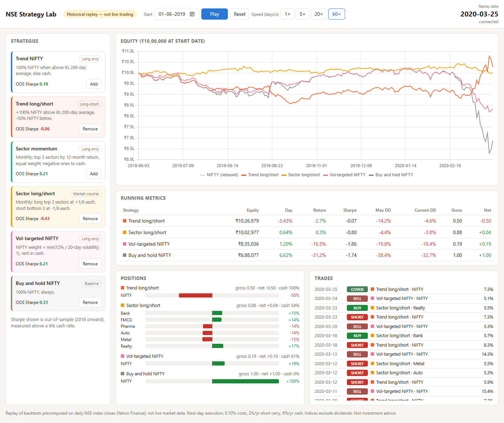
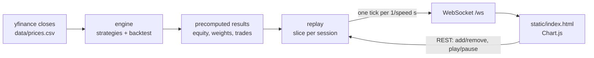

# NSE Strategy Lab

**A backtesting engine for NSE long/short strategies, plus a dashboard that replays them day by day.**

> ⚠️ The dashboard is a **replay of historical data, not live trading**. Every number below comes from an actual run on NSE index closes from 2008-01-01 to 2026-11-13.

1. A strategy is one function: given prices up to today, it returns target weights, where a negative weight is a short position.
2. The engine runs every strategy through NSE history from 2008 with next-day execution, costs and short-borrow fees, and a unit test proves no strategy can see future prices.
3. A web page replays that history day by day: each visitor adds or removes strategies and watches equity curves, long/short positions, trades and running metrics update as the replay plays.



## Architecture



- **Engine** (`engine/`): on day t a strategy sees `prices.loc[:t]` only. The engine fills its target at t+1's close, trades only when a weight moves by more than 5 percentage points, caps gross exposure at 1.0, and charges 0.10% of traded value. Cash earns 6% a year, and shorts pay a 2% yearly borrow/carry fee.
- **Precompute**: backtests are deterministic, so all six run once (at build time on Render) and are loaded at startup. A replay only reads slices, so many viewers cost almost nothing.
- **Sessions** (`app/sessions.py`): an anonymous UUID cookie, not IP-based (shared Wi-Fi and mobile carriers put many users on one IP). State lives in memory with a 30-minute idle expiry and at most 6 strategies per session.

## Strategies

| ID | Rule | Style |
|---|---|---|
| `trend` | 100% NIFTY above its 200-day average, else cash | Long only |
| `trend_ls` | +100% NIFTY above its 200-day average, −50% below | Long-short |
| `sector_mom` | Monthly: top 3 of 8 sector indices by 12-month return, equal weight; negative ones go to cash | Long only |
| `sector_ls` | Monthly: long top 3 sectors at +1/6 each, short bottom 3 at −1/6 each | Market-neutral |
| `voltarget` | NIFTY weight = min(12% ÷ 20-day vol, 1), rest cash | Long only, risk-sized |
| `buy_hold` | 100% NIFTY | Baseline |

The settings above were fixed in advance and never tuned on 2018 onward.

## Results

Sharpe is measured **above the 6% cash rate**. Turnover is total weight traded per year.

**Out of sample (2018-01-01 → 2026-11-13)**

| Strategy | Ann. return | Vol | Sharpe | Max DD | Worst month | Turnover |
|---|---|---|---|---|---|---|
| Trend | 7.6% | 11.4% | 0.18 | −22.5% | −6.4% | 7.8 |
| Trend L/S | 4.5% | 13.0% | −0.06 | −31.6% | −6.9% | 11.9 |
| Sector momentum | 8.4% | 18.1% | 0.21 | −37.0% | −22.4% | 4.6 |
| Sector L/S | 2.2% | 8.1% | −0.43 | −17.6% | −8.2% | 4.1 |
| Vol-target | 8.1% | 11.9% | 0.21 | −19.8% | −11.1% | 2.6 |
| Buy & hold NIFTY | **10.7%** | 16.9% | **0.33** | −38.4% | −23.2% | 0.0 |

**In sample (2008 → 2017)**

| Strategy | Ann. return | Vol | Sharpe | Max DD |
|---|---|---|---|---|
| Trend | 8.4% | 13.8% | 0.22 | −21.2% |
| Trend L/S | 3.6% | 15.5% | −0.08 | −31.1% |
| Sector momentum | 13.2% | 13.2% | 0.55 | −21.4% |
| Sector L/S | 4.9% | 6.5% | −0.15 | −20.5% |
| Vol-target | 7.1% | 12.2% | 0.13 | −21.4% |
| Buy & hold NIFTY | 5.6% | 22.9% | 0.09 | −59.9% |

**Stress periods**

| Strategy | 2008 | Feb–Apr 2020 | Worst drawdown since 2021 |
|---|---|---|---|
| Trend | +6.0%\* | +0.2% | −13.8% |
| Trend L/S | +4.1%\* | +5.9% | −16.8% |
| Sector momentum | +6.0%\* | −29.6% | −25.6% |
| Sector L/S | +6.0%\* | −3.8% | −14.6% |
| Vol-target | −15.9% | −10.7% | −17.9% |
| Buy & hold NIFTY | −52.1% | −15.8% | −17.2% |

\* Warm-up, not skill. The data starts in January 2008, so the 200-day average only exists from about October 2008, and 12-month sector returns only from 2009. These strategies sat in cash through most of the 2008 crash because they had no signal yet.

**What it shows:** no rule beat buy-and-hold NIFTY on return or Sharpe out of sample. Vol-targeting and trend roughly halved the maximum drawdown (−19.8% and −22.5% vs −38.4%) while giving up about 2.5–3 points of annual return. Trend L/S was short through the March 2020 crash (+5.9% over Feb–Apr) but stayed short into the rebound until July.

### Robustness (out-of-sample Sharpe / max DD per setting; defaults marked \*)

| Trend MA | 50 | 100 | 150 | 200\* | 250 |
|---|---|---|---|---|---|
| Sharpe | 0.22 | 0.23 | 0.17 | 0.18 | 0.11 |
| Max DD | −17.1% | −17.2% | −17.8% | −22.5% | −19.8% |

| Sector momentum Sharpe | top 2 | top 3 | top 4 |
|---|---|---|---|
| 3-month | 0.42 | 0.46 | 0.49 |
| 6-month | 0.02 | 0.07 | 0.10 |
| 9-month | 0.18 | 0.37 | 0.29 |
| 12-month | −0.07 | 0.21\* | 0.26 |

| Vol-target Sharpe / Max DD | 10-day | 20-day | 60-day |
|---|---|---|---|
| 8% | 0.19 / −13.7% | 0.23 / −13.7% | 0.19 / −18.4% |
| 10% | 0.24 / −16.2% | 0.21 / −17.3% | 0.19 / −21.7% |
| 12% | 0.27 / −18.4% | 0.21 / −19.8%\* | 0.19 / −25.4% |
| 15% | 0.29 / −20.9% | 0.29 / −23.9% | 0.24 / −29.3% |

- **Trend and vol-targeting are robust.** Their drawdowns beat NIFTY's −38.4% at every setting, and vol-target's drawdown falls steadily as the target falls.
- **Sector momentum is fragile.** Its Sharpe jumps between neighbouring lookbacks with no pattern.
- **Defaults were not changed** to the best-looking cell, because that would be tuning on the test period.

## Run it

```bash
uv sync
uv run pytest                                # 44 tests: no look-ahead, backtest maths, replay
uv run python -m engine.data                 # data checks + reports/chart1_growth.png
uv run python -m engine.report               # scorecards, stress table, reports/chart2_equity_drawdown.png
uv run python -m engine.sensitivity          # robustness grid -> reports/sensitivity.csv
uv run uvicorn app.main:app --reload         # then open http://localhost:8000
```

The price data is committed (`data/prices.csv`), so nothing needs internet. Use `python -m engine.data --refresh` to download again.

**Deploy (Render):** `render.yaml` defines one free web service. The build step precomputes the backtests into `data/results.pkl`, so startup only loads them (about 140 MB RAM). It must stay a single instance, because sessions live in memory.

## Tests

- `tests/test_no_lookahead.py`: for every strategy and 6 dates, multiplying every later price by 10 and adding 30 fake days must not change the decision. A separate check proves the test would catch a leak.
- `tests/test_backtest_math.py`:
  - buy-and-hold at zero cost equals NIFTY;
  - all-cash earns exactly the cash rate;
  - a −100% short returns exactly −NIFTY's return, and the borrow fee appears as −size × daily rate;
  - no trades means no cost.
- `tests/test_replay.py`: cookie session, REST controls and WebSocket ticks. Dates increase, equity matches the precomputed backtest, and a removed strategy disappears from the next tick.

## Limitations

- **Historical replay, not live data**, and not investment advice.
- **Prices:** indices are price indices; they exclude dividends and are not directly tradable.
- **Shorts:** modelled as futures-style positions with a flat 2% yearly carry, not real futures with roll costs.
- **Flat assumptions:** 6% cash rate and 0.10% cost per trade.
- **Hindsight in the universe:** the 8 sector indices were chosen today. Five of them only start in 2010–2011, so the sector strategies have the full universe only from about 2012.
- **2008 warm-up:** this flatters the in-sample results of the trend and sector strategies (see the stress table).
- **Data repair:** Yahoo's GOLDBEES data had a broken 1:100 split on 2019-12-19 and 2019-12-20; those two days were repaired automatically.
- **Sessions:** in-memory, so a restart clears them, and the app runs as a single instance.
